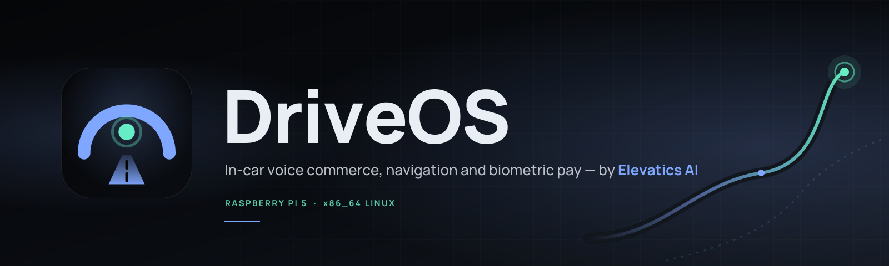
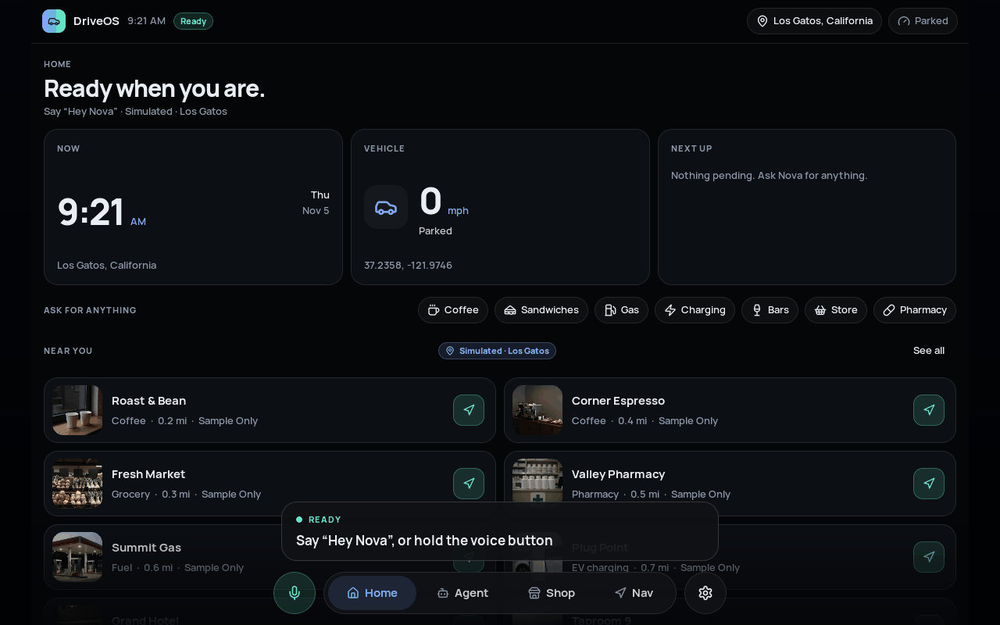
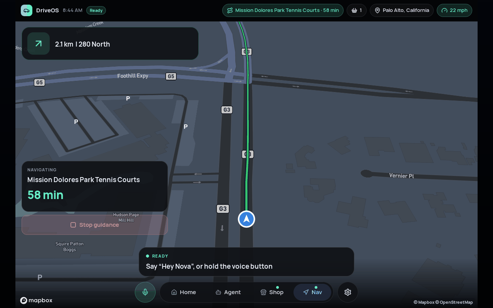
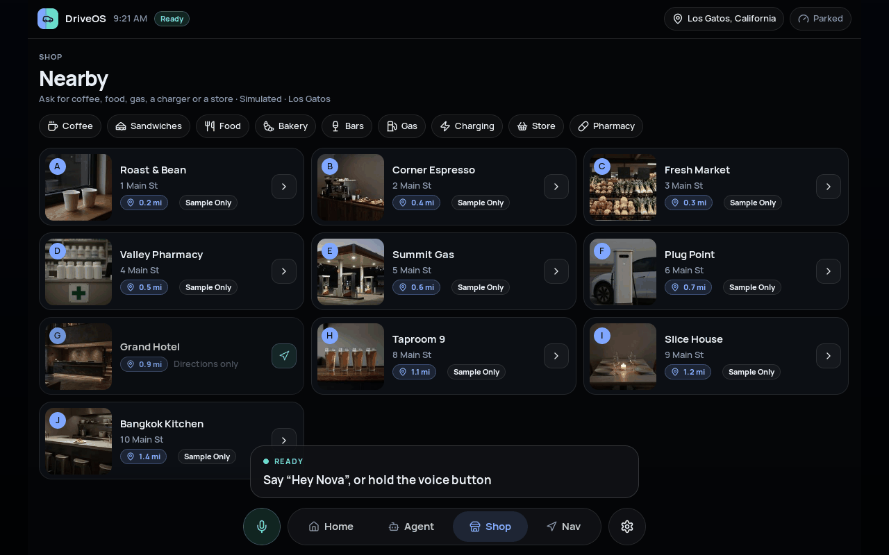
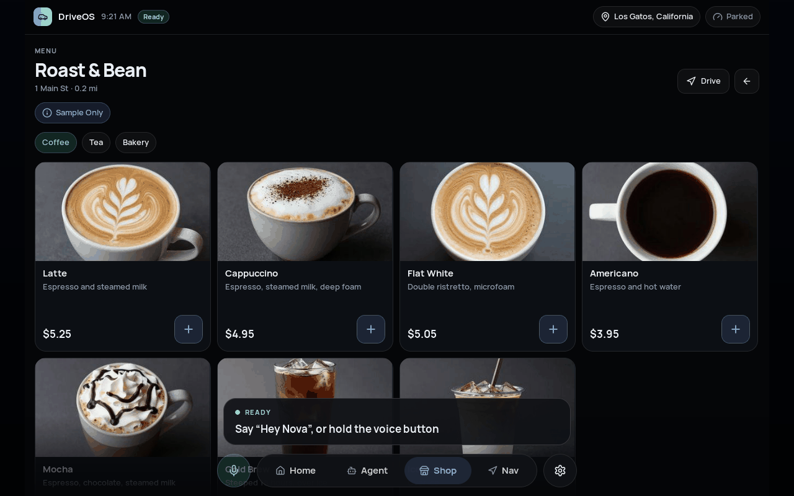
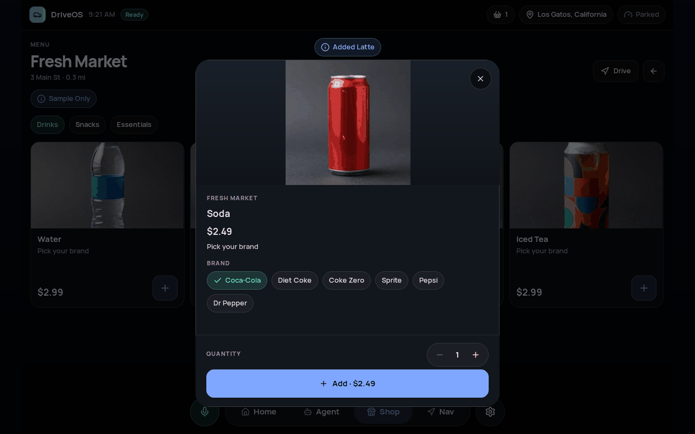
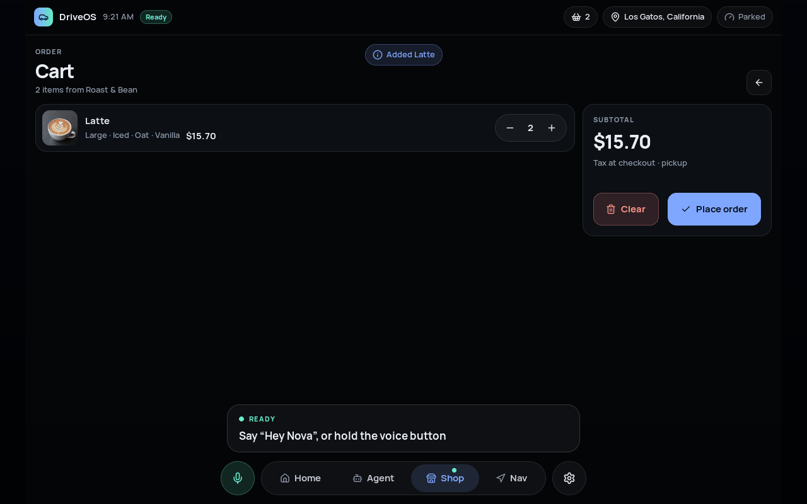
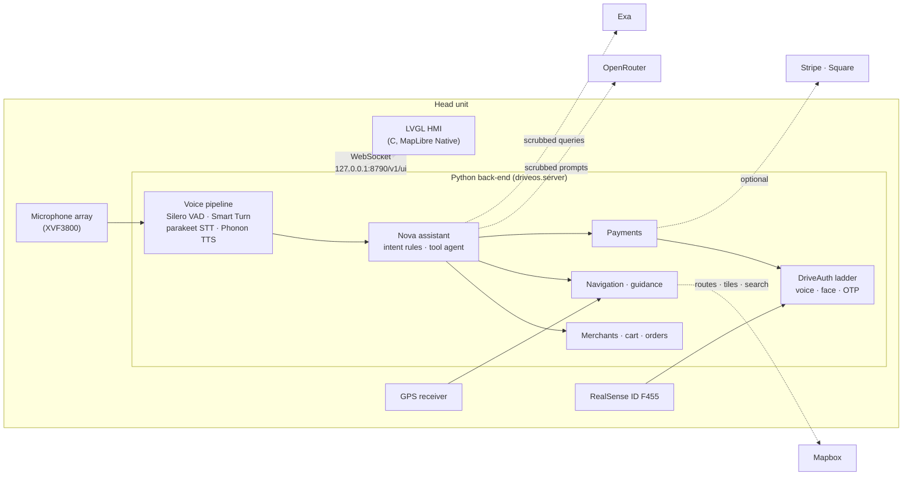

<div align="center">



<p>
  
  
  
  
  
</p>

<p>
  <a href="INSTALL.md">Install</a> ·
  <a href="#features">Features</a> ·
  <a href="#screenshots">Screenshots</a> ·
  <a href="#architecture">Architecture</a> ·
  <a href="#configuration">Configuration</a> ·
  <a href="PRIVACY.md">Privacy</a> ·
  <a href="CHANGELOG.md">Changelog</a>
</p>

</div>

DriveOS is an in-car assistant platform that lets a driver find a place, order, pay and navigate to pickup by voice, with the
speech stack, the payment decision and the user interface running on the head unit. A Python back-end hosts the Nova
assistant (wake phrase, on-device speech recognition, intent rules, an optional tool-using language-model agent), the
merchant and payment layers, and the biometric approval ladder. A native LVGL front-end renders the interface over a
local WebSocket and runs on a Raspberry Pi 5 or an x86_64 Linux machine. Payments never rely on a
language model: consent is decided by on-device rules and by DriveAuth.

## Features

**Voice ordering, on the device.** Say "Hey Nova" and ask for coffee, a sandwich, fuel or a charger. Wake-phrase
spotting and speech-to-text run locally with [parakeet.cpp](https://github.com/mudler/parakeet.cpp) (NVIDIA
parakeet-tdt_ctc-110m, CPU, GGUF), with Silero VAD and Smart Turn v3 for turn-taking and faster-whisper as a fallback.
Replies are spoken by the Phonon text-to-speech model. Wheel-button barge-in, follow-up turns without the wake phrase and a
continuous-conversation mode are built in.

**Voice-first biometric payment ladder.** Every order passes through DriveAuth Edge
(Apache-2.0), which weighs trust and risk and chooses the lightest safe approval: spoken confirmation for small amounts, a
voice-ID challenge with random digits and advisory anti-spoof measurement, Face ID, then a one-time code. Anti-spoof
scores do not approve or reject payments by themselves. The exact amount is re-priced and shown before any approval.

**F455 Face ID.** Intel RealSense ID F455 support over USB, with **Settings → Face ID** enrollment, re-enrollment,
existing-face linking and deletion, plus a live camera preview during enrollment and approval. Manage up to five named
driver/passenger profiles, edit metadata, and select the active driver; passengers cannot approve checkout. Templates stay
inside the camera; DriveOS stores only a private user mapping and never deletes linked AI Box entries.

**One-time-code step-up.** Codes arrive by SMS (Twilio) or as a phone notification on screen, can be spoken or typed, are
limited to three attempts and are masked in every log.

**Navigation.** MapLibre Native renders Mapbox styles on the head unit, with traffic-aware routing, congestion-coloured
routes, spoken turn-by-turn guidance, lane guidance, automatic re-routing and a follow-the-car view. Live GPS (NMEA over serial,
gpsd, TCP/UDP) or a simulated drive.

**Real nearby places.** Search for fuel, chargers, cafes, pharmacies and stores along the route or around the car, with
ratings, hours and photos where the provider supplies them. A bundled sample catalogue keeps the demo working offline.

**Web search.** An optional [Exa](https://exa.ai) tool answers open questions (opening hours, reviews, charger status).
Queries are scrubbed on the device first: no names, addresses, coordinates, card numbers or contact details.

**Privacy by design.** Biometric templates and audio never leave the device. Personal files are created owner-only, logs
carry no transcripts by default, conversation history is purged on a schedule, and the language-model provider is asked for
zero data retention. See [PRIVACY.md](PRIVACY.md).

## Screenshots

<table>
  <tr>
    <td width="50%"><br><sub>Home: location, vehicle state and places near you.</sub></td>
    <td width="50%"><br><sub>Navigation: Mapbox map, route, manoeuvre and ETA.</sub></td>
  </tr>
  <tr>
    <td width="50%"><br><sub>Shop: nearby places by category.</sub></td>
    <td width="50%"><br><sub>A menu with item photos.</sub></td>
  </tr>
  <tr>
    <td width="50%"><br><sub>Item options and quantity.</sub></td>
    <td width="50%"><br><sub>Cart with variants and subtotal.</sub></td>
  </tr>
</table>

Food and cover images in the demo catalogue are generated, labelled "Sample Only" in the interface, and listed in
[THIRD_PARTY_NOTICES.md](THIRD_PARTY_NOTICES.md).

## Architecture



Solid lines stay on the device. Dotted lines are optional cloud calls that you enable with a key; see
[PRIVACY.md](PRIVACY.md) for exactly what each one receives. The front-end and the back-end are separate processes, so
either can restart without the other.

## Quick start

The fastest way to run DriveOS on a Raspberry Pi 5 is the AppImage from the
[Releases](../../releases) page; on any other Linux machine, build from source.

```bash
# AppImage (aarch64)
chmod +x DriveOS-*-aarch64.AppImage
./DriveOS-*-aarch64.AppImage

# From source (details and prerequisites in INSTALL.md)
bash scripts/setup.sh
.venv/bin/driveos doctor
scripts/run_pi.sh          # back-end + LVGL HMI
```

[INSTALL.md](INSTALL.md) covers Raspberry Pi 5 and x86_64: system packages, the speech models, the audio
setup, the F455 SDK and troubleshooting. Demo mode needs no accounts or keys.

## Hardware

| Part | Notes |
|---|---|
| Raspberry Pi 5 (Raspberry Pi OS Bookworm or Trixie, arm64) | Reference platform. Active cooling is recommended: speech models load the CPU. |
| x86_64 Linux (Ubuntu 22.04 or later) | Development and demos. |
| reSpeaker XVF3800 USB microphone array | Recommended. Any ALSA/PipeWire microphone works. |
| Intel RealSense ID F455 | Optional, for Face ID. |
| NMEA GPS receiver (USB serial) or gpsd | Optional; the drive can be simulated. |
| Display, 1280 × 800 or larger | Wayland, X11 or DRM/KMS. |

## Configuration

DriveOS reads `~/.config/driveos/config.toml` (the AppImage uses `~/.config/drive-os/`), or the file named by
`DRIVEOS_CONFIG`. Start from [`config.example.toml`](config.example.toml); every key can also be set from the environment as
`DRIVEOS_<SECTION>__<KEY>`. Secrets belong in a `.env` file (mode 0600) and are never read from inside the AppImage.
Copy [`.env.example`](.env.example) and fill in only the services you use:

```ini
# live map, routing and place search (https://account.mapbox.com)
DRIVEOS_MAPBOX__TOKEN=pk.your-token-here

# conversational agent through OpenRouter (on-device rules still handle approvals)
DRIVEOS_NLU__ENGINE=harness
OPENROUTER_API_KEY=sk-or-your-key-here

# web search for the agent
EXA_API_KEY=your-key-here
```

Without keys DriveOS runs in demo mode: a sample catalogue, a simulated car and simulated payments.

## Privacy

Voice prints, face templates and raw audio stay on the device. Only the services you configure receive data, and only
the minimum: scrubbed prompts to OpenRouter (zero data retention requested), route and search requests to Mapbox, and
scrubbed queries to Exa. The full inventory, retention periods and how to erase your data are in
[PRIVACY.md](PRIVACY.md).

## Development

```bash
uv sync --extra voice --extra biometrics --extra gps --extra dev
QT_QPA_PLATFORM=offscreen .venv/bin/pytest -q
.venv/bin/ruff check src tests
cmake -S hmi_lvgl -B hmi_lvgl/build && cmake --build hmi_lvgl/build && ctest --test-dir hmi_lvgl/build
```

Tests that need models or hardware skip themselves. Contract documents for the front-end protocol live next to the
HMI: [`hmi_lvgl/CHECKOUT_CONTRACT.md`](hmi_lvgl/CHECKOUT_CONTRACT.md), [`hmi_lvgl/NAV_CONTRACT.md`](hmi_lvgl/NAV_CONTRACT.md),
[`hmi_lvgl/PLACES_CONTRACT.md`](hmi_lvgl/PLACES_CONTRACT.md) and [`hmi_lvgl/ENROLL_CONTRACT.md`](hmi_lvgl/ENROLL_CONTRACT.md).
Packaging is described in [`packaging/README.md`](packaging/README.md) and the merchant MCP server in
[`docs/MCP.md`](docs/MCP.md).

## Licence

Copyright (c) 2026 Elevatics AI. All rights reserved. DriveOS is proprietary software; see [LICENSE](LICENSE). Third-party
components are used under their own licences, listed in [THIRD_PARTY_NOTICES.md](THIRD_PARTY_NOTICES.md).

## Acknowledgements

DriveOS builds on DriveAuth Edge, [parakeet.cpp](https://github.com/mudler/parakeet.cpp)
and NVIDIA's parakeet-tdt_ctc-110m, [Silero VAD](https://github.com/snakers4/silero-vad),
[Smart Turn](https://github.com/pipecat-ai/smart-turn), [faster-whisper](https://github.com/SYSTRAN/faster-whisper),
[WeSpeaker](https://github.com/wenet-e2e/wespeaker), [AASIST](https://github.com/clovaai/aasist), [LVGL](https://lvgl.io),
[MapLibre Native](https://github.com/maplibre/maplibre-native), [Mapbox](https://www.mapbox.com), [Manrope](https://github.com/sharanda/manrope),
[Lucide](https://lucide.dev) and the Phonon speech model. Thank you to their authors and maintainers.
